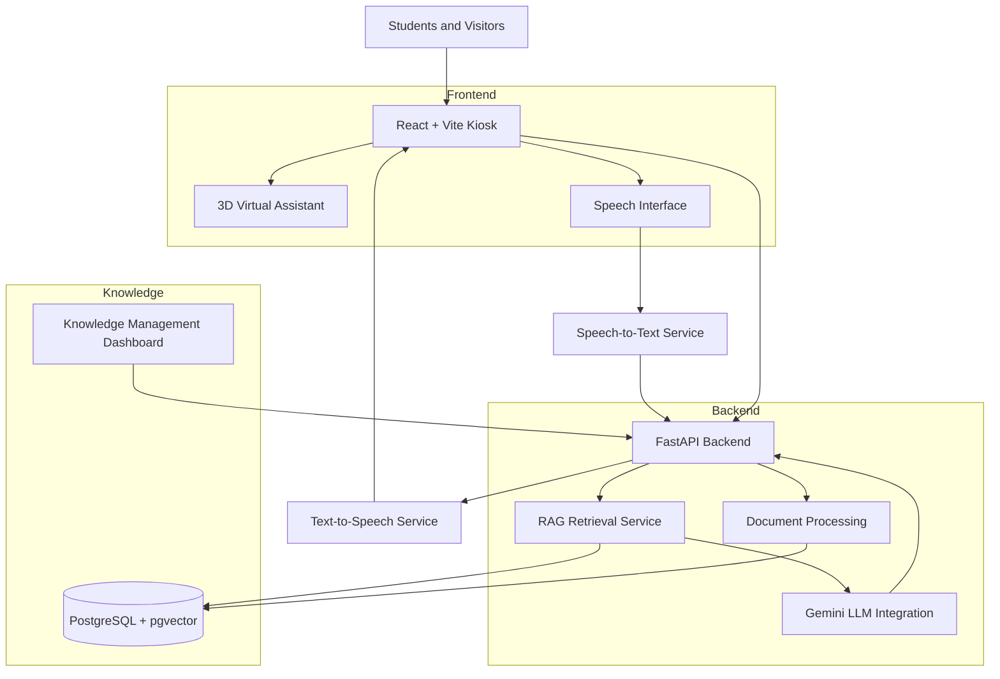

# Northstar University AI Kiosk
### AI-Powered Voice Agent and Interactive Virtual Information Kiosk

An AI-powered virtual university assistant designed to provide students, visitors and prospective applicants with interactive access to university information through natural language conversations.

The system combines Large Language Models (LLMs), Retrieval-Augmented Generation (RAG), speech technologies and 3D virtual assistants to deliver an interactive information kiosk experience.

It also includes a Knowledge Management Dashboard that allows administrators to upload and manage university documents, extending the assistant's knowledge base without modifying the application code or retraining the language model.

---

## 1. Project Overview

The Northstar University AI Kiosk provides the following capabilities:

- **AI Conversational Assistant:** Answers university-related questions using an integrated LLM.
- **Knowledge-Based Question Answering:** Uses RAG to retrieve relevant information from university documents.
- **Voice Interaction:** Supports speech input and spoken responses through speech-to-text and text-to-speech services.
- **3D Virtual Assistant:** Provides an interactive virtual assistant experience.
- **Male and Female Assistants:** Supports virtual assistant presentation options.
- **Knowledge Management Dashboard:** Allows administrators to upload and manage university knowledge documents.
- **Dynamic Knowledge Updates:** Makes newly uploaded document information available for future queries.

## 2. System Architecture

The application follows a frontend and backend architecture with separate components for AI processing and knowledge management.



### Main Components

| Component | Responsibility |
|---|---|
| Kiosk Frontend | User interface and conversational interaction |
| FastAPI Backend | API management and application logic |
| Gemini | AI response generation |
| RAG Service | Relevant knowledge retrieval |
| PostgreSQL + pgvector | Document data and vector embeddings |
| Speech Services | Speech recognition and voice generation |
| 3D Avatar | Virtual assistant presentation |
| Knowledge Dashboard | Administrative document management |

## 3. Technology Stack

### Frontend
- React
- Vite
- TypeScript
- Three.js
- React Three Fiber
- React Three Drei

### Backend
- Python
- FastAPI
- Uvicorn
- SQLAlchemy
- Pydantic

### Artificial Intelligence
- Google Gemini API
- Retrieval-Augmented Generation (RAG)
- Text embeddings
- Semantic similarity search

### Database
- PostgreSQL
- pgvector

### Speech Processing
- Speech-to-Text (STT) integration
- Text-to-Speech (TTS) integration

### Development Tools
- Visual Studio Code
- Git and GitHub
- Docker
- Postman

## 4. Project Structure

The project is organised into separate frontend, backend and knowledge management applications.

```text
AI-Voice-Agent/
│
├── frontend/
│   ├── public/
│   │   └── models/
│   │       └── avatars/
│   │
│   ├── src/
│   │   ├── components/
│   │   ├── services/
│   │   ├── utils/
│   │   ├── assets/
│   │   └── ...
│   │
│   ├── package.json
│   └── .env
│
├── backend/
│   ├── app/
│   │   ├── api/
│   │   ├── models/
│   │   ├── schemas/
│   │   ├── services/
│   │   ├── routes/
│   │   └── main.py
│   │
│   ├── requirements.txt
│   ├── .env
│   └── venv/
│
├── knowledge-hub-frontend/
│   ├── src/
│   ├── public/
│   ├── package.json
│   └── .env
│
├── docker-compose.yml
├── .gitignore
└── README.md
```

*Note: The structure above illustrates the main project components. Some internal folders may differ depending on the current implementation.*

---

## 5. Prerequisites

Install the following software before setting up the project:

| Software | Requirement |
|---|---|
| Node.js | 18 or later |
| npm | Compatible with installed Node.js |
| Python | 3.10 or later |
| PostgreSQL | With pgvector extension |
| Docker Desktop | Recommended for database setup |
| Git | Latest stable version |

You will also need API access for the configured AI and speech providers.

---

## 6. Installation and Setup

### Step 1: Clone the Repository

```bash
git clone <YOUR_GITHUB_REPOSITORY_URL>
```

Navigate into the project directory:

```bash
cd AI-Voice-Agent
```

### Step 2: Configure the Database

Start the PostgreSQL database using the supplied Docker Compose configuration, if provided.

```bash
docker compose up -d
```

Ensure PostgreSQL is running and the pgvector extension is available.

The backend database connection must point to the configured PostgreSQL instance.

### Step 3: Set Up the Backend

Navigate to the backend directory:

```bash
cd backend
```

Create a Python virtual environment:

```bash
python -m venv venv
```

Activate the virtual environment on Windows PowerShell:

```powershell
.\venv\Scripts\Activate.ps1
```

Install Python dependencies:

```bash
pip install -r requirements.txt
```

Create a `.env` file inside the `backend` directory using the sample configuration below.

Start the FastAPI server from the `backend` directory:

```bash
uvicorn app.main:app --reload
```

The backend should be accessible at:

```text
http://127.0.0.1:8000
```

FastAPI interactive API documentation:

```text
http://127.0.0.1:8000/docs
```

### Step 4: Set Up the Main Kiosk Frontend

Open another terminal and navigate to the frontend directory:

```bash
cd frontend
```

Install dependencies:

```bash
npm install
```

Create the frontend `.env` file and configure the backend API URL.

Start the development server:

```bash
npm run dev
```

Open the local URL displayed in the terminal.

### Step 5: Set Up the Knowledge Management Dashboard

Open another terminal:

```bash
cd knowledge-hub-frontend
```

Install dependencies:

```bash
npm install
```

Create the dashboard `.env` file and configure its backend API URL.

Start the dashboard:

```bash
npm run dev
```

Open the local URL displayed in the terminal.

---

## 7. Environment Configuration

The following examples demonstrate how to configure the application without exposing credentials.

**Important:** These are sample variable names. Use the exact variable names expected by your existing application configuration.

### Backend Environment

Create:

`backend/.env`

```env
# Application
APP_NAME=Northstar University AI Kiosk
DEBUG=True

# Database
DATABASE_URL=postgresql://<DB_USER>:<DB_PASSWORD>@<DB_HOST>:5432/<DB_NAME>

# Google Gemini
GEMINI_API_KEY=<YOUR_GEMINI_API_KEY>
GEMINI_MODEL=<YOUR_CONFIGURED_GEMINI_MODEL>

# Speech-to-Text
STT_API_KEY=<YOUR_STT_API_KEY>

# Text-to-Speech
TTS_API_KEY=<YOUR_TTS_API_KEY>

# CORS
FRONTEND_URL=http://localhost:5173
ADMIN_FRONTEND_URL=http://localhost:5174
```

### Main Frontend Environment

Create:

`frontend/.env`

```env
VITE_API_BASE_URL=http://localhost:8000
```

### Knowledge Management Dashboard Environment

Create:

`knowledge-hub-frontend/.env`

```env
VITE_API_BASE_URL=http://localhost:8000
```

**Security notes:**

- Never commit actual API keys, passwords or database credentials to GitHub.
- Keep backend credentials in the backend environment.
- Only expose values prefixed with `VITE_` that are safe for browser access.
- Add `.env` files to `.gitignore`.
- Use `.env.example` files to share configuration templates.

---

## 8. Knowledge Retrieval Workflow (RAG)

The application uses Retrieval-Augmented Generation to provide responses based on university knowledge documents.

The general workflow is:

1. An administrator uploads a PDF document through the Knowledge Management Dashboard.
2. The backend extracts text from the document.
3. The extracted content is divided into smaller text chunks.
4. Embeddings are generated for the text chunks.
5. Embeddings and associated document information are stored in PostgreSQL using pgvector.
6. A user submits a question through the kiosk.
7. The question is converted into an embedding.
8. The system retrieves relevant document chunks using similarity search.
9. Retrieved information is provided as context to the Gemini model.
10. The model generates a response based on the retrieved context.

This allows administrators to extend the knowledge base by uploading new documents without retraining the language model.

---

## 9. Running the Complete Application

For local development, run the following components in separate terminals:

| Component | Command |
|---|---|
| Database | `docker compose up -d` |
| Backend | `uvicorn app.main:app --reload` |
| Kiosk Frontend | `npm run dev` |
| Knowledge Dashboard | `npm run dev` |

Run the backend command from the `backend` directory and the frontend commands from their respective directories.

---

## 10. Testing the Application

The following scenarios can be used to verify the main functionality:

### AI Kiosk
- Ask general university-related questions.
- Test admission and academic programme questions.
- Test student service questions.
- Test text-based conversations.
- Test speech input and spoken responses.
- Test male and female virtual assistant options.

### Knowledge Management
- Log in to the administrative dashboard.
- View existing knowledge documents.
- Upload a new PDF document.
- Verify successful document processing.
- Confirm that the document appears in the knowledge list.

### RAG Verification
- Ask a question about information not currently in the knowledge base.
- Confirm that the system does not provide an unsupported specific answer.
- Upload a document containing the required information.
- Ask the same question again.
- Verify that the assistant retrieves and uses the newly uploaded information.

---

## 11. Known Limitations

- The current kiosk interface can benefit from further visual and usability improvements.
- AI response quality depends on the accuracy and relevance of the available knowledge documents.
- Speech recognition and voice generation depend on the availability and limitations of the configured external providers.
- Processing large documents may require additional time and resources.
- AI-generated responses may occasionally require verification against the original university documents.
- Internet connectivity is required for external AI and speech services.

## 12. Future Improvements

Potential future enhancements include:

- Further improvements to the kiosk's visual design and accessibility.
- Enhanced 3D avatar animations and facial expressions.
- Improved speech interaction and multilingual support.
- More advanced document management and knowledge categorisation.
- Improved retrieval accuracy and document source references.
- Production deployment, monitoring and performance optimisation.

## 13. Author

**Chiran Samarasekara**

AI Voice Agent and Interactive Virtual Information Kiosk

Developed as part of the technical assessment for **QMINIMORE Pty Ltd**.

---

## 14. Acknowledgement

This project was developed using modern web technologies, AI services and open-source frameworks to demonstrate the practical implementation of an AI-powered conversational information kiosk with document-based knowledge retrieval.